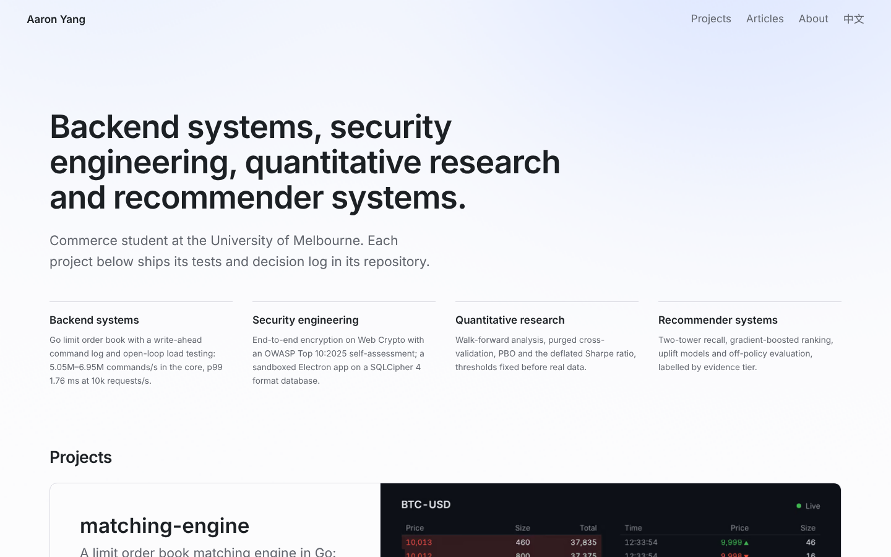
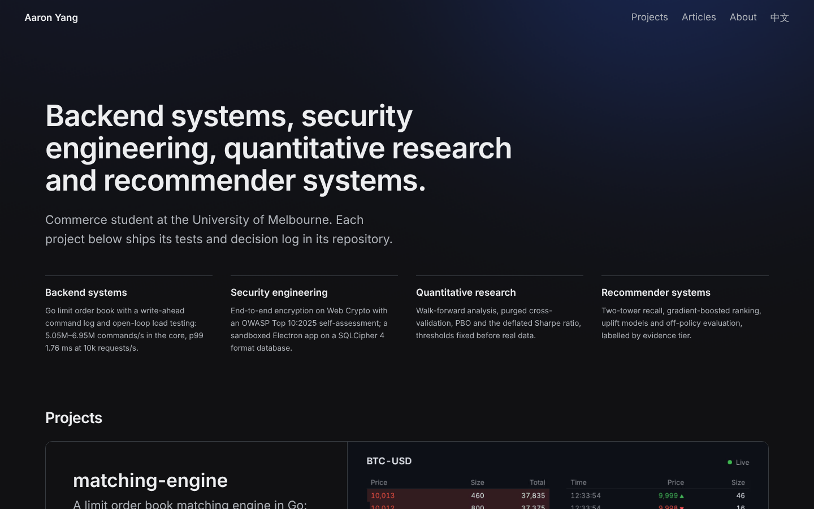
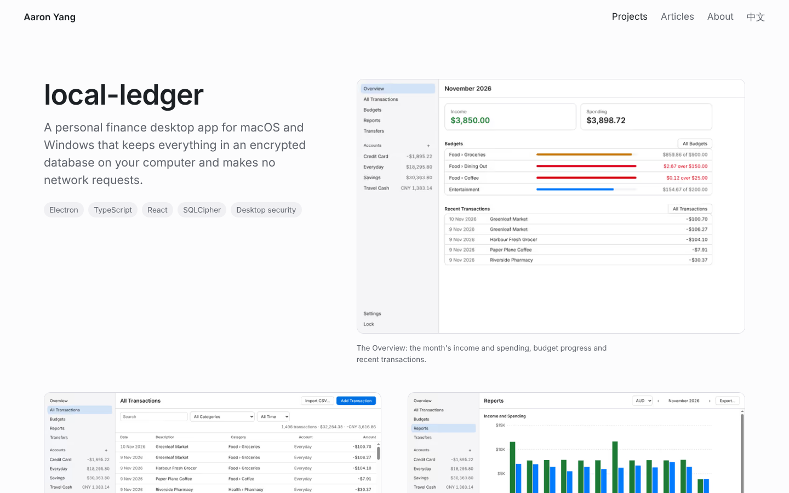
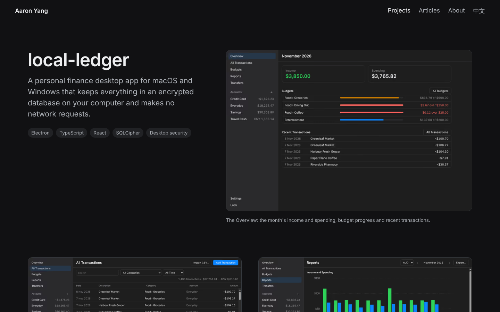

# portfolio-site

Personal website of Aaron Yang. Built with Astro and TypeScript, with a hand-written WebGL2 and GLSL background.

Live at [shyanorn.github.io/portfolio-site](https://shyanorn.github.io/portfolio-site/).

## Pages

- Home: a headline, a two-sentence introduction and the four areas of the work, over the WebGL2 background ([D015](docs/DECISIONS.md), [D017](docs/DECISIONS.md)), then the projects as picture cards, the first one full width ([D020](docs/DECISIONS.md))
- `/projects/<slug>/`: one page per project, from `src/content/projects/<slug>.json` ([D012](docs/DECISIONS.md), [D013](docs/DECISIONS.md)); each project's numbers are traced to its repository in `docs/project-sources/<slug>.md`
- `/articles/` and `/articles/<slug>/`: articles about the projects, in MDX ([D005](docs/DECISIONS.md)), and the full-text feed at `/rss.xml` ([D016](docs/DECISIONS.md))
- `/about/`: education, the four areas with what each project built and measured, and the tools, from `src/content/site/about.json` ([D017](docs/DECISIONS.md)); each statement is traced in `docs/project-sources/about.md`

Every page but the 404 page also exists in Chinese under `/zh/` ([D011](docs/DECISIONS.md)). The pages sit in a 1280 px container: from 768 px the home page sets its areas and cards two a row and About puts its headings beside the text, from 1024 px project and article pages add side columns, and below about 736 px every page is one column, apart from the metrics ([D020](docs/DECISIONS.md)).

## Screenshots

At 1440×900 ([D019](docs/DECISIONS.md)).

| Light | Dark |
| --- | --- |
|  |  |
|  |  |

## Lighthouse

The live site at `d7001a6` on 2026-11-10, with CI's settings ([D019](docs/DECISIONS.md)): the mobile preset three times per page, the median run kept, and the desktop preset once. Each cell is performance / accessibility / best practices / SEO. Mobile performance on the Chinese pages is the median of seven runs: on the live site their longest layout task runs after first contentful paint and counts as blocking time, and single runs of one page ranged from 85 to 100 ([D020](docs/DECISIONS.md)).

| Page | Mobile | Desktop |
| --- | --- | --- |
| `/` | 100 / 100 / 100 / 100 | 100 / 100 / 100 / 100 |
| `/zh/` | 99 / 100 / 100 / 100 | 100 / 100 / 100 / 100 |
| `/about/` | 100 / 100 / 100 / 100 | 100 / 95 / 100 / 100 |
| `/zh/about/` | 100 / 100 / 100 / 100 | 100 / 95 / 100 / 100 |
| `/articles/` | 100 / 100 / 100 / 100 | 100 / 100 / 100 / 100 |
| `/zh/articles/` | 100 / 100 / 100 / 100 | 100 / 100 / 100 / 100 |
| `/articles/cryptography-held/` | 100 / 100 / 100 / 100 | 100 / 100 / 100 / 100 |
| `/zh/articles/cryptography-held/` | 100 / 100 / 100 / 100 | 100 / 100 / 100 / 100 |
| `/articles/locking-ends-a-process/` | 100 / 100 / 100 / 100 | 100 / 100 / 100 / 100 |
| `/zh/articles/locking-ends-a-process/` | 100 / 100 / 100 / 100 | 100 / 100 / 100 / 100 |
| `/articles/low-pbo-easy-question/` | 100 / 100 / 100 / 100 | 100 / 100 / 100 / 100 |
| `/zh/articles/low-pbo-easy-question/` | 100 / 100 / 100 / 100 | 100 / 100 / 100 / 100 |
| `/articles/order-book-cpu/` | 100 / 100 / 100 / 100 | 100 / 100 / 100 / 100 |
| `/zh/articles/order-book-cpu/` | 100 / 100 / 100 / 100 | 100 / 100 / 100 / 100 |
| `/projects/backtest-lab/` | 100 / 100 / 100 / 100 | 100 / 100 / 100 / 100 |
| `/zh/projects/backtest-lab/` | 99 / 96 / 100 / 100 | 100 / 100 / 100 / 100 |
| `/projects/local-ledger/` | 100 / 100 / 100 / 100 | 100 / 100 / 100 / 100 |
| `/zh/projects/local-ledger/` | 99 / 96 / 100 / 100 | 100 / 100 / 100 / 100 |
| `/projects/matching-engine/` | 100 / 100 / 100 / 100 | 100 / 100 / 100 / 100 |
| `/zh/projects/matching-engine/` | 99 / 100 / 100 / 100 | 100 / 100 / 100 / 100 |
| `/projects/push-lab/` | 100 / 100 / 100 / 100 | 100 / 100 / 100 / 100 |
| `/zh/projects/push-lab/` | 99 / 96 / 100 / 100 | 100 / 100 / 100 / 100 |
| `/projects/vault-share/` | 100 / 100 / 100 / 100 | 100 / 100 / 100 / 100 |
| `/zh/projects/vault-share/` | 99 / 100 / 100 / 100 | 100 / 100 / 100 / 100 |

Where accessibility is below 100, the contrast check read text partway through its entrance fade: the About pages on desktop ([D020](docs/DECISIONS.md)) and the gallery captions of three Chinese project pages on mobile.

## Development

Requires Node.js 22.23.4 or later.

```bash
npm install
npm run dev                            # http://localhost:4321
npm run build && npm run preview
npm test                               # unit tests
npm run lint && npm run typecheck && npm run format:check
npm run budget                         # JS each page loads, gzipped; limit 150 kB
npm run e2e                            # axe, overflow, links and keyboard, on the built site
npm run screenshots && npm run audit   # screenshots, then the overflow and axe table
node scripts/copy-export.ts <project>…  # a project's text, one file per language, in artifacts/
node scripts/site-image.ts             # after a build: the site's share images, when the home introduction changes
```

`npm run screenshots` saves a full-page screenshot of every page to `artifacts/screens/`, and the home page background as `home-{390,1440}-{light,dark}-{t0,t10,t20,still,fallback}.png`: three points of the animation, the still frame and the CSS fallback. `BACKGROUND_TIMES=0,30,90` picks other points, in seconds. `PERF=1 npx playwright test tests/e2e/background-perf.spec.ts` prints what the background costs two phones with the CPU slowed 4 and 6 times.

`SITE_URL` and `BASE_PATH` set the origin and base path ([D007](docs/DECISIONS.md)). Deploys take both from the GitHub Pages settings, and local builds serve from the root. To check a build under a base path, set `BASE_PATH` for both the build and the checks:

```bash
export BASE_PATH=/portfolio-site
npm run build && npm run e2e
```

## Deploy

The Deploy workflow runs by hand ([D009](docs/DECISIONS.md)). Afterwards, `node scripts/check-live.mjs <site URL>` checks the live site: pages, links and assets under the base, share images, the sitemap, the 404 page, trailing-slash redirects and the feed's links. New pages go in its `routes` list.

## License

MIT for code. Written content and images are all rights reserved.
